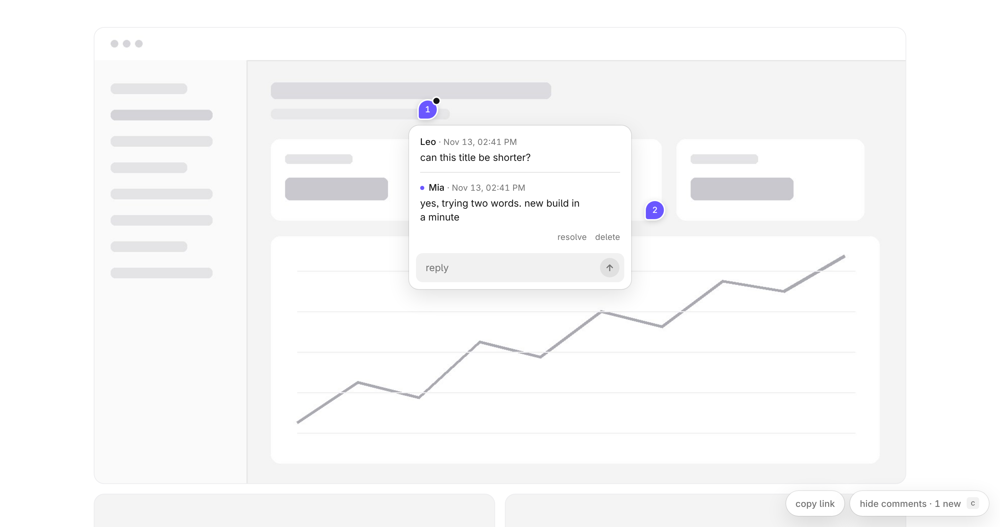
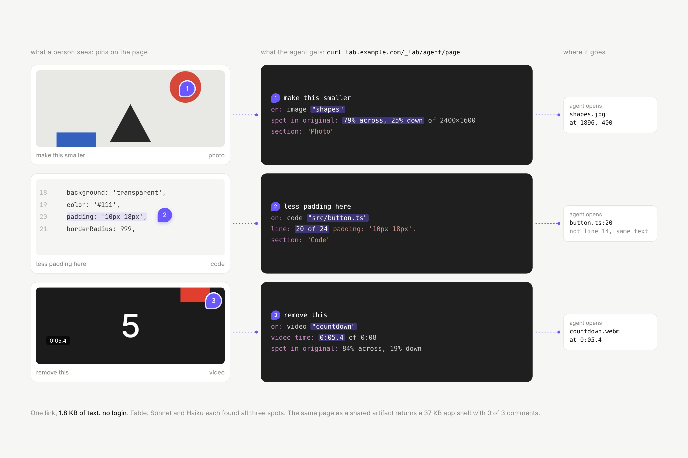

# labfb

[](https://www.npmjs.com/package/@leonidstern/labfb) [](https://github.com/LeonidStern/labfb/actions/workflows/test.yml) [](LICENSE)

Pin comments on pages, and your agent reads them as plain text. Use it on a live domain where anyone with the link can comment, or on your own computer, where Claude answers on the pins while it works.



## Features

**Cloud lab**: pages on a domain, for people you share links with
- **No account:** anyone with the link clicks anywhere, types a name and comments.
- **One link for your agent:** "copy link" gives plain text with every open comment. Paste it into any agent and it goes to the file.
- **Knows what's under the pin:** the quoted words, the element, the image file and pixel, the code line, the video second. No screenshots needed.
- **One domain, many repos:** the lab domain only proxies `/<name>/*` to each member's own repo and Vercel project.
- **Admin links per person:** let someone resolve and delete on their pages only. Nothing to set up per person.

**Local lab**: pages on your computer, for you and Claude
- **No deploy:** run `npx @leonidstern/labfb` in your project. It finds your running Astro, Next or Vite dev server and puts comments on top, or serves plain HTML files.
- **Claude answers on the pin:** it hears each comment as you post it, edits the file, the page reloads, and the reply shows on the pin.
- **Shows who is listening:** the label says whether Claude is listening or working. Close the page and Claude waits quietly: your first comment when you're back wakes it, and it stops after an hour.
- **Quick model first:** when Claude Code is installed, small, clear changes are done by a fast model in a few seconds. `--no-fast` turns it off.
- **Phone too:** `--wifi` lets a phone at home join. Comments stay in `.lab/`, one store per project.

Both: works on text, code, photos and video, drag your pins, hold Option to comment on links and buttons, 19 KB gzipped, and a [Claude skill](skills/labfb/SKILL.md) that knows both flows.

## Cloud lab

Paste this into your agent. It is the whole setup.

```text
Set up labfb (https://github.com/leonidstern/labfb) for me on Vercel.

1. Fork the repo and import it into Vercel: framework preset "Other", no build command.
2. Add Upstash Redis from the Vercel Marketplace (free tier). It sets KV_REST_API_URL and KV_REST_API_TOKEN.
3. Set env vars: LAB_HOST=<lab domain, e.g. lab.example.com> and LAB_COMMENTS_ADMIN_TOKEN=<output of `openssl rand -hex 24`>. Tell me the token. Redeploy so the variables apply.
4. Add <lab domain> to the Vercel project and tell me the DNS record to create.
5. For each site that should get comments (slug = a short name, e.g. anna):
   - serve it under the base path /<slug> (Astro `base`, Next `basePath`, Vite `base`) from its own Vercel project; every page answers 200, no redirects
   - add two rewrites to labfb's vercel.json:
     { "source": "/<slug>", "destination": "https://<their-project>.vercel.app/<slug>" },
     { "source": "/<slug>/:path*", "destination": "https://<their-project>.vercel.app/<slug>/:path*" }
   - add this to the site's shared layout, before </body>:
     <script src="https://<lab domain>/_lab/comments.js" defer></script>
   - put pages at /<slug>/<project>/<secret>/<page>, where <secret> is 10 random characters per project; mark them noindex and link to them from nowhere
6. Once I confirm the DNS works: POST a test comment with curl to https://<lab domain>/_lab/api/comments
   ({"page":"/_lab/demo","name":"setup","text":"test"}, content-type application/json) and check that
   https://<lab domain>/_lab/agent/_lab/demo shows it as text. Then delete it with header x-lab-admin: <token>.
```

- **Comment:** open a page through the lab domain, press `c` (or hold Option), then click or drag. Drag your own pin to move it.
- **Read:** `https://<lab domain>/_lab/agent/<page path>` returns every open comment as plain text. Paste it into your agent.
- **Resolve or delete:** open any page once with `#lab-admin=<token>`.
- **Admins:** ask your agent "make a lab admin link for anna on /anna". With your token it gets a link that lets anna resolve and delete comments on `/anna` pages only. One browser can hold links for several labs. Nothing to set up per person (how: top of `api/lab-comments.mjs`).

## Local lab

Paste this into Claude Code in your project. It is the whole setup.

```text
Start labfb (https://github.com/leonidstern/labfb) on this project and listen to my comments.

1. Run `npx @leonidstern/labfb` here in the background. It finds this project's dev server, or serves plain HTML files.
   If it says the dev server isn't running, start it the way this project does, then run it again. Never stop other servers.
2. Run `npx @leonidstern/labfb wait` in the background, with --name set to this project's name. It ends with my next comment.
3. For each comment, change what it asks, then answer on the pin: `npx @leonidstern/labfb reply <id> "Done: …"`, with the id
   that wait printed. Add --resolve when it's fully done; if you need something from me, ask in the reply instead.
4. Run wait again right away. Stop when wait says the page was closed.
```

Using it often? Install the plugin once, then just say **"start labfb"** in any project:

```text
/plugin marketplace add leonidstern/labfb
/plugin install labfb@leonidstern
```

Without Claude, run `npx @leonidstern/labfb` in your project:

- **Dev server (Astro, Next, Vite…):** start it as usual. labfb finds the one running from this project, even with other projects' servers running, and puts comments on top. `--proxy 4321` picks a port yourself.
- **Plain HTML files:** served as they are. Pages somewhere else: `npx @leonidstern/labfb dist`.

- **Comment:** press `c` (or hold Option) and click. Drag to mark an area.
- **All your labs:** `npx @leonidstern/labfb pages` writes `.lab/lab-pages.md`, every running lab's pages as links with open comment counts. Claude sends it to you, so in the desktop app it sits under Outputs.
- **Options:** `--no-fast` turns off the quick model, `--wifi` lets a phone at home join. `npx @leonidstern/labfb preview` opens it in the Claude desktop app's preview pane. `--help` has the rest.
- **Files:** comments stay in `.lab/` in the project. Delete it to start over. Add `.lab/` to `.gitignore`.

## Both



- **Page hints:** `data-uncommentable` keeps comments off a part of the page; `data-comment-target` pins any click inside to that element. Same names as Claude artifact comments.
- **Theme:** set `--lab-accent`, `--lab-bg`, `--lab-fg`, `--lab-radius` or `--lab-font` on `[data-lab-comments]`.

Development: `npm test` runs the local-mode checks (Node 20+, no packages). Changes are in [CHANGELOG.md](CHANGELOG.md).

Tested with Claude: on a page with a photo, code and a video, Fable, Sonnet and Haiku found every spot from the link alone (file, pixel, line, second), see [bench](bench/). Admin links and deleting are tested across three labs in [bench/labs](bench/labs/). The script is 19 KB gzipped and loads after the page. Links are hidden, not locked, so don't put anything confidential there.

MIT · Inter under the SIL OFL · made by [leonidstern](https://github.com/LeonidStern) · [OOZE](https://ooze.design)
